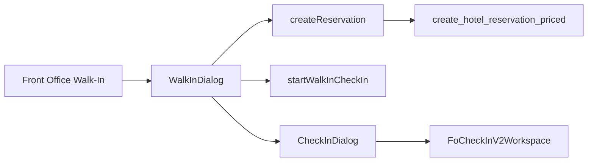
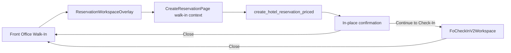

# Front Office Walk-In → Reservation Workspace Audit

Read-only audit of the current Walk-In action and how it should reuse Reservations → New Reservation. No application, migration, or data changes were made.

## 1. Current Walk-In entry points

| Entry | File | What it opens |
|---|---|---|
| Front Office quick action `walk_in` | `front-office-workspace.tsx` `onQuickAction` | local `setWalkIn(true)` |
| Room rack Walk-In | same file, `RoomRackCalendar.onWalkIn` | same local flag |
| Walk-ins desk create | `walk-ins-workspace.tsx` | the same `WalkInDialog` |

There is no Walk-In route. The dialog is `WalkInDialog` in `front-office-dialogs.tsx`.

Writes:

- `createReservation` in `reservations.functions.ts`
- then `startWalkInCheckIn` in `fo-check-in.functions.ts`

`createReservation` calls `create_hotel_reservation_priced` (or `create_hotel_reservation_priced_commercial` / overbooking only when those inputs are sent). The dialog does not send packages, promotions, or overbooking, so the normal path is `create_hotel_reservation_priced`.

`startWalkInCheckIn` updates `hotel_reservations.source = 'walk_in'` and inserts/patches `fo_checkin_progress.walk_in_incomplete = true`. It does not check the guest in.

The dialog also reads guests (`listGuests`), availability (`getRoomTypeAvailability`), assignable rooms (`listAssignableRooms`), and quotes (`quoteStay`). Guest create opens the existing guest form dialog. It does not post a payment.

## 2. Current workflow

Classification: **D plus a separate check-in handoff**. It is not a second reservation RPC, and it does not check in inside the create command. It is also not the New Reservation overlay. Front Office “New Reservation” (`new_reservation`) navigates to `/restaurant/bookings/new` and leaves Front Office.

## 3. Existing New Reservation workspace

Reservations Desk opens overlay state `{ type: "new-reservation" }` inside `ReservationWorkspaceOverlay` in `reservations-workspace.tsx`. The body is `CreateReservationPage` with `embedded`.

That page already supports:

- `initialGuestId`, company, travel agent, and group
- guest search and guest create through Guest Profile
- stay dates, room type, `listAssignableRooms`, rate quotes, packages, promotions
- commercial source, market segment, guarantee, notes, requests
- single and multi-room create
- in-place confirmation and `onOpenCreatedReservation`
- `onCreated` and `onCancel` / `onReturnToDesk`

It does not have a walk-in mode. Arrival defaults to `propertyToday(timezone)`, which is the property calendar date, not `restaurants.business_date`.

The overlay host lives inside the Reservations workspace. Front Office cannot mount that same overlay today without either hosting it or navigating away.

## 4. Navigation contract

Reservations:

- New Reservation sets `overlay` to `new-reservation`
- close calls `closeWorkspaceOverlay(false)`
- success can replace the overlay with `reservation-detail`
- `initialCreate` and return-path search can restore create after refresh on the Reservations route

Front Office Walk-In is a boolean in component state. Closing the dialog returns to the current Front Office view. Refresh drops the dialog. That local-state behavior is the right refresh model for a Front Office launch. Do not put Walk-In on the Reservations `initialCreate` route.

## 5. Walk-In mode

`CreateReservationPage` accepts initial account ids and callbacks. It does not accept:

- `mode: "walk-in"`
- a business-date arrival
- a fixed channel source
- a preselected room type or room
- a “continue to check-in” action

Smallest extension: add an optional walk-in context to the existing page and overlay state, for example `mode: "standard" | "walk-in"`, plus the defaults below. Do not add a second create component.

## 6. Defaults that are already safe

| Default | Current Walk-In | Safe to reuse |
|---|---|---|
| Arrival | Front Office `today` from `usePropertyBusinessDate` | Yes |
| Departure | arrival + 1 night, editable | Yes |
| Adults / children | 1 / 0 | Yes |
| Status | `confirmed` | Yes. Create accepts `pending` or `confirmed` |
| Room | required in the dialog | Product choice. Create allows unassigned |
| Rate plan | required by the dialog before submit | Yes, through `quoteStay` |
| Channel source | hardcoded `source: "walk_in"` | Only as `hotel_reservations.source`, not as a commercial source id |
| Check-in | offered after create, not inside create | Yes |

There is no property-configured Walk-In commercial source record used by this dialog. `hotel_reservations.source` is a technical enum (`staff`, `walk_in`, `direct_booking`). Commercial booking source is a separate catalogue field on New Reservation.

## 7. Business date

Walk-In arrival already uses `usePropertyBusinessDate`: persisted `restaurants.business_date`, falling back to the property timezone date. Night Audit uses the same resolver.

`CreateReservationPage` does not. If Walk-In is moved onto that page without an explicit arrival, a closed business date and the browser/property calendar can disagree.

Same-day pricing works in the dialog because `quoteStay` and `createReservation` receive `arrival: today`.

## 8. Guest

Walk-In searches `listGuests` and can open the guest form. It does not use the New Reservation guest step, duplicate review, booker, or preference defaults.

Target: keep guest search and create inside `CreateReservationPage`. Do not add another guest writer.

## 9. Room type and assignment

The dialog requires a room type with availability and a room from `listAssignableRooms`. It passes `roomId` into `createReservation`, which sends `_room_id` to `create_hotel_reservation_priced`. The dialog does not update `room_id` itself and does not call `assign_hotel_reservation_room_unit`.

New Reservation uses the same availability and assignable-room reads and the same create argument. That is the assignment path to reuse. Room can stay unassigned on the reservation create contract; the current Walk-In dialog is stricter than the writer.

## 10. Rate and pricing

The dialog calls `quoteStay`, then sends `ratePlanId` to `createReservation`. The priced RPC calculates the snapshot. There is no Walk-In rate formula and no manual rate field.

Packages and promotions are omitted, so the commercial RPC is not used. New Reservation already chooses `create_hotel_reservation_priced_commercial` when those selections exist. Walk-In should inherit that branch by using the same page, not by copying it.

## 11. Source and market segment

Walk-In writes the technical source `walk_in` twice: once in `createReservation` after the RPC, and again in `startWalkInCheckIn`. The priced INSERT still starts as `staff`; the follow-up update changes it. Commercial booking source and market segment are left empty.

New Reservation persists configured commercial source, segment, and external reference ids. A Walk-In mode should keep `hotel_reservations.source = 'walk_in'` and, when a property source is selected, also store that commercial source. Do not replace the commercial catalogue with the string `"walk-in"`.

## 12. Status

Create as `confirmed`. Do not create as `checked_in`.

`startWalkInCheckIn` only marks check-in progress incomplete. `CheckInDialog` is `FoCheckInV2Workspace` and completes check-in later through the Front Office check-in command.

## 13. Continue to Check-In

Current success closes `WalkInDialog` and opens check-in:

- Front Office: `onCreated` sets the check-in step and calls `openDialog("checkin", created)`
- Walk-ins desk: `onCreated` sets `checkInStay`

`CreateReservationPage` already has `onCreated(reservationId)` and `onOpenCreatedReservation`. The Reservations overlay uses the second callback to open reservation detail. A walk-in context needs a third confirmation action, “Continue to Check-In”, that stays in the overlay and does not use the old check-in stepper. `CheckInDialog` already ignores `initialStep` and opens Check-In v2 at guest/reservation.

## 14. Check-In v2

`FoCheckInV2Workspace` requires `restaurantId`, `reservationId`, and `open`. `reservationRoomId` is optional. Front Office opens it through `CheckInDialog` with the stay id. It can switch units inside the workspace.

Walk-In should pass the created reservation id and, when the create result identifies the unit, that `reservationRoomId`. No second check-in flow.

## 15. Multi-room

New Reservation can create one room or several room units. Walk-In v1 is one room: one type, one `roomId`, no `roomUnits` payload. Keep that as the walk-in default. Do not add a Walk-In-only multi-room creator. If multi-room is later allowed, it is the existing reservation-mode control.

## 16. Payment and deposit

`WalkInDialog` sends no payment, deposit, or guarantee. `createReservation` can post those only when the New Reservation money fields are present, and that post stays in Cashiering through `open_folio_for_reservation` and folio transactions.

Check-In v2 reads deposit readiness separately. Walk-In must not gain its own payment form.

## 17. Folio

A folio is not created by the Walk-In dialog or by `startWalkInCheckIn`. `createReservation` opens one only when a create-time payment or guest deposit needs posting. Otherwise the folio opens on the first Cashiering or check-in financial post. Walk-In should keep that rule.

## 18. Packages and promotions

New Reservation supports both and routes them through `create_hotel_reservation_priced_commercial`. Walk-In does not collect them. Reusing the page makes them available. Do not add Walk-In package logic.

## 19. Requests and notes

New Reservation already writes special requests, notes, and guest preferences. Walk-In currently sends none (`specialRequests: null` on the local stay). Reuse the reservation fields. No walk-in note table.

## 20. Legacy Walk-In backend

There is no `create_walk_in_reservation` RPC. The tests lock that absence.

Keep:

- `createReservation` / `create_hotel_reservation_priced`
- `hotel_reservations.source = 'walk_in'`
- `listFrontOfficeWalkInsDesk`, `WalkInsWorkspace`, and walk-in history
- `FoCheckInV2Workspace`

Retire later, only after the overlay path replaces them:

- `WalkInDialog` as a create form
- the duplicate guest, room, and quote UI inside that dialog

`startWalkInCheckIn` can remain until Check-In v2 itself records `walk_in_incomplete` for a walk-in-created reservation. Other screens still use it as the “created but check-in not finished” marker.

## 21. Overlay behavior

`ReservationWorkspaceOverlay` is a dialog on wide screens and a sheet below that. It can host `CreateReservationPage` without changing the route. It is currently rendered only by `ReservationsWorkspace`.

Target: Front Office mounts the same overlay component, or the same workspace host, with `new-reservation` plus walk-in context. Front Office stays mounted underneath. Close returns to the current Front Office view. Success stays in the overlay. Continue to Check-In swaps the overlay body to `FoCheckInV2Workspace` or opens `CheckInDialog` without a route change.

Do not use `/restaurant/bookings/new` for this action. That is the current Front Office “New Reservation” navigation and it leaves the desk.

## 22. Refresh and back

Walk-In state is not in the URL, so refresh and browser back close it and stay on Front Office. Preserve that.

Do not copy Reservations `initialCreate` persistence onto the Front Office route. A refresh should not reopen an unfinished walk-in create.

## 23. Permissions

`createReservation` and `startWalkInCheckIn` both use `requireReservationManager`: Front Office module, roles owner, manager, receptionist.

Guest create uses the Guest Profile manager gate. Room eligibility is inside the reservation availability and assignable-room reads. Rate selection uses `quoteStay`. Check-In v2 completion uses the Front Office check-in permission. Payment posting, if the reused page collects it, still requires Cashiering operator rights and does not belong to the Walk-In button itself.

A receptionist who can create a reservation and check in can run the target flow. A user without Guest Profile create rights can still link an existing guest.

## 24. History

Reservation create already writes the reservation `created` history with the actor inside the priced RPC. The technical source is patched afterward, so the created row can still show the initial `staff` source unless a later history row records the patch. Commercial source is not set by Walk-In. Unit rows are created by the priced function. Room assignment is the `_room_id` on that create, not a separate assignment event from the dialog.

No new Walk-In event type is needed. The created reservation should keep `source = walk_in`, and the commercial source should be whatever New Reservation persists. `walk_in_incomplete` remains operational progress, not reservation history.

## 25. Capability matrix

| Capability | Current Walk-In | New Reservation | Owner | Reuse | Gap |
|---|---|---|---|---|---|
| Open | Local dialog | `new-reservation` overlay | Front Office launch, Reservations UI | Yes | Overlay is not mounted in Front Office |
| Guest search | `listGuests` | Create guest step | Guest Profile | Yes | Thinner search |
| Guest create | Guest form | Create guest step | Guest Profile | Yes | Duplicate entry |
| Dates | Business date + 1 night | Calendar today | Reservations | Yes | Create page ignores business date |
| Room type | Availability query | Same query | Room & Inventory | Yes | None |
| Room | Required, assignable list | Optional, same list | Room & Inventory | Yes | Dialog is stricter |
| Rate plan | `quoteStay` | Same | Rate & Revenue | Yes | None |
| Pricing | Priced RPC | Same RPC | Rate & Revenue | Yes | None |
| Source | Hardcoded `walk_in` | Commercial catalogue | Reservations | Partial | Technical source is not the catalogue |
| Segment | Empty | Catalogue | Reservations | Yes | Not collected |
| Status | Confirmed | Pending or confirmed | Reservations | Yes | Pass confirmed |
| Guarantee | Omitted | Collected | Reservations | Yes | Not in dialog |
| Deposit / payment | None | Optional Cashiering post | Cashiering | Yes | Do not add a Walk-In post |
| Packages | None | Supported | Reservations | Yes | Inherit the page |
| Requests / notes | None | Supported | Reservations | Yes | Inherit the page |
| Create | `createReservation` | Same | Reservations | Yes | None |
| Confirmation | Toast, dialog closes | In-place panel | Reservations | Yes | Need a check-in action |
| Continue to Check-In | Opens Check-In v2 | Opens reservation detail | Front Office | Yes | Callback differs |
| Close | Returns to Front Office | Returns to Reservations | Host screen | Yes | Host must stay Front Office |

## 26. Duplication register

| Area | Decision |
|---|---|
| `createReservation` and priced RPC | KEEP |
| `source = walk_in` | KEEP |
| Walk-in desk, history, incomplete progress | KEEP |
| Check-In v2 | KEEP |
| Guest search/create inside `WalkInDialog` | REMOVE LATER |
| Room and quote form inside `WalkInDialog` | REMOVE LATER |
| Separate rate math | None exists |
| Payment inside Walk-In | None exists. Do not add |
| Check-in inside create | None exists. Do not add |

## 27. Target flow

Walk-in context sets arrival to the property business date, departure to the next day, status `confirmed`, technical source `walk_in`, and leaves commercial source, guest, room, and rate on the existing reservation steps. `startWalkInCheckIn` still marks progress incomplete until Check-In v2 owns that flag.

## 28. Verdict

1. Walk-In opens `WalkInDialog`, a standalone Front Office dialog.
2. It does not open New Reservation.
3. It does not duplicate the reservation writer. It duplicates the create UI.
4. It uses `createReservation` → `create_hotel_reservation_priced`.
5. Guest search and create are a second, thinner Guest Profile entry.
6. Room choice uses the shared assignable-room read, then passes `roomId` into create. It does not assign through a second writer.
7. Pricing uses `quoteStay` and the priced RPC. There is no separate calculator.
8. Property business date is available and is what the dialog uses. New Reservation does not use it yet.
9. A configured commercial Walk-In source is not used. The technical source `walk_in` is hardcoded.
10. Create the reservation as `confirmed`.
11. New Reservation can accept defaults only after a small context extension. Initial guest and account ids already exist.
12. The overlay component can be mounted from Front Office. It is not mounted there now.
13. Close can return to Front Office if Front Office remains the host.
14. Success can stay in the overlay. Reservations already does this for detail. Walk-In should stay for confirmation instead of closing immediately.
15. Check-In v2 can launch inline through `CheckInDialog` / `FoCheckInV2Workspace` with the new reservation id.
16. Payment posting is already outside the Walk-In dialog. Keep it that way.
17. Multi-room Walk-In is not supported. New Reservation multi-room should not be copied into the dialog.
18. `WalkInDialog`’s form can be retired after the overlay path replaces it. Keep the desk, history, and `walk_in` source.
19. No new reservation RPC is required. A walk-in context on the existing create page and overlay is the product change. Business-date arrival must be supplied by that context.
20. First increment: open the existing `ReservationWorkspaceOverlay` and `CreateReservationPage` from Front Office in walk-in mode, without leaving Front Office and without a new create command.

## Recommended increments

1. **WI01 — shared overlay from Front Office.** Mount the existing overlay on the Front Office host. Walk-In opens `new-reservation`. Close stays on Front Office. Do not route to `/restaurant/bookings/new`.
2. **WI02 — walk-in context.** Pass business-date arrival, one-night departure, `confirmed`, and `source: "walk_in"` into `CreateReservationPage`. Keep guest, room, rate, packages, notes, and guarantee on the current steps.
3. **WI03 — confirmation action.** Add “Continue to Check-In” that opens `FoCheckInV2Workspace` for the created reservation and unit. Keep “Open Reservation” optional. Mark `walk_in_incomplete` through the existing progress command until Check-In v2 owns it.
4. **WI04 — retire the dialog form.** Point both Walk-In buttons at WI01. Leave the walk-in desk and history in place.
5. **WI05 — tests.** Source locks that Walk-In no longer owns a create form, plus business-date defaults, confirmed status, no check-in inside create, and close-back behavior.

---

**FRONT OFFICE WALK-IN → RESERVATION WORKSPACE AUDIT: COMPLETE**

Audit document: `docs/pms/front-office-walk-in-reservation-audit.md`

Frontend changes: NONE

Backend changes: NONE

Database changes: NONE
