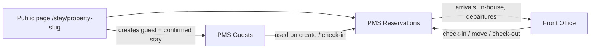

# Hotel UAT — Reservations, Front Office, Website booking

Use this as an outsider. You do not need to read code. Tick each box only after you did the step yourself and saw the result.

This file covers three modules:

1. **Reservations and guests**
2. **Front Office desk**
3. **Public website booking** (`/stay/...` — the guest-facing booking page, not a marketing website)

When every **Must pass** box is ticked, and every **Honest gap** is recorded as expected (not a surprise), you can say these three modules work together.

**A skip is not a pass.** If you did not run it, leave it empty.

---

## How to use this

For each item:

1. Follow **Do this**.
2. Confirm **Pass looks like**.
3. Tick `- [x]` if it passed.
4. If it failed, write one line under **Notes** at the bottom: what you clicked, what you expected, what happened.

Mark:

| Mark | Meaning |
|---|---|
| **Must pass** | Required before you can say the module works |
| **Should pass** | Important. If it fails because setup is incomplete, fix setup and retry before blaming the module |
| **Honest gap** | Known incomplete on purpose. Record it. Do not fail the three modules for this |

---

## What “working” means here

Working means a hotel can:

- Create a real guest
- Create a real reservation against live rooms and rates
- Find that reservation on the desk
- Check the guest in, move them, and check them out
- Let a guest book the same inventory from the public page
- See that website booking appear in PMS as a normal reservation

Working does **not** mean:

- A full hotel marketing website
- OTA / Booking.com / channel-manager go-live (Aiosell is a separate channel)
- Night audit, housekeeping engine, or full cashiering ledger as their own UAT
- Guest **Financial** card (it is still a placeholder)
- Reservation **Communication** and **Linked Reservations** tabs (they are deferred)

Those sit beside these three modules. Touch them only when a desk step needs them (for example: check-in needs a ready room; check-out needs the folio settled).

---

## How the three pieces connect

One guest master. One reservation record. Front Office runs the stay. The website is another way to create that same reservation.

---

## 0. Before you start

Do this once. If this section fails, stop. The three modules cannot look “broken” because rooms or rates were never set up.

### Property you need

- [ ] **Must pass** — You can sign in as hotel staff and open PMS.
- [ ] **Must pass** — Property Setup Card 2 has at least one **room type**, **physical rooms**, **rate plan**, and **amenities**.
- [ ] **Must pass** — Property Setup Card 2 **Meal Plans & Packages** has at least one meal plan if you will sell a meal-inclusive rate.
- [ ] **Must pass** — Distribution is on: **PMS → Distribution**. **Accept direct bookings** is **On**. Copy the public link (`/stay/your-slug`).
- [ ] **Should pass** — At least one room is **clean / inspected** so check-in is not blocked by housekeeping.
- [ ] **Should pass** — You know today’s **business date** (Front Office / dashboard). Use that date for “today” arrivals, not your phone’s calendar if they differ.

### Test people you will create

Write the names here before you start, then reuse them:

| Role | Name / email / phone | Confirmation no. (fill later) |
|---|---|---|
| Guest A — desk booking | | |
| Guest B — website booking | | |
| Guest C — walk-in | | |
| Company / TA (optional) | | |

---

## 1. Reservations and guest workflows

Open **PMS → Guests** (`/restaurant/pms/guests`) and **PMS → Reservations** (`/restaurant/pms/reservations`).

### 1.1 Create and find a guest

- [ ] **Must pass** — Switcher shows **Individual / Company / Group / Travel Agent**.
- [ ] **Must pass** — Create **Guest A** (first name, last name, phone or email). Save. They appear in Directory search.
- [ ] **Must pass** — Open Guest A. **Personal** and **Contact** show the data you typed. Edit a phone or email, save, reopen: the change is still there.
- [ ] **Should pass** — Upload or record an **identity document** on Identity. Staff can see it is there (this is staff verify, not government KYC).
- [ ] **Should pass** — Set a **preference** (smoking, pillow, etc. if the catalogue has options). Save. It is still there after refresh.
- [ ] **Should pass** — Create a **Company** and a **Travel Agent** (or Group). Open each master. Names persist.
- [ ] **Should pass** — On Guest A → **Business**, link employer / bill-to / booker TA if you created those masters. The link shows on the guest; it does **not** split a folio.
- [ ] **Honest gap** — Guest **Financial** says it is a placeholder. That is expected. Do not treat missing city-ledger as a guest-module fail.

### 1.2 Create a reservation at the desk

Start from Reservations → **New reservation** (or `/restaurant/bookings/new`). Four steps: **Guest, Stay & Availability** → **Booking Details** → **Policies & Payment** → **Review & Confirm**.

- [ ] **Must pass** — Search and select **Guest A**. You are not forced to type a second guest from scratch.
- [ ] **Must pass** — Pick arrival / departure that has rooms. Occupancy (adults / children) is required. A room type with a live rate shows a price.
- [ ] **Must pass** — If you pick dates with no rooms, the screen says so. It does not invent availability.
- [ ] **Must pass** — Continue through Booking Details and Policies & Payment without the page dying.
- [ ] **Must pass** — Review shows guest, dates, room type, rate, occupancy. Confirm. You get a **confirmation number**.
- [ ] **Must pass** — That confirmation appears on **Reservations → All Reservations** and on Guest A → **Stays & Reservations**.
- [ ] **Should pass** — Assign a physical room from the reservation (or from Front Office Assign). The room number shows on the reservation.
- [ ] **Should pass** — Open the reservation. Tabs **Overview**, **Stay & Rooms**, **Guest**, **Folio & Payments**, **Requests & Notes**, **History** open without error.
- [ ] **Honest gap** — **Communication** and **Linked Reservations** may be marked deferred. Expected.

### 1.3 Change, copy, cancel (before check-in)

Use a **second** future reservation so you do not destroy Guest A’s arrival you will check in later.

- [ ] **Must pass** — Search by guest name and by confirmation number. The right stay opens.
- [ ] **Must pass** — Filters: Arrivals / Departures / Unassigned / Pending return the kind of stay you expect for today’s business date.
- [ ] **Should pass** — Amend dates or occupancy on a confirmed stay. The new dates save. Price may change; the screen should say so rather than silently keep the old total.
- [ ] **Should pass** — Copy a reservation. A new stay is created; the original stays.
- [ ] **Must pass** — Cancel a **test** confirmed stay (not Guest A if you still need them). Status becomes cancelled. It does not stay in Arrivals as if it were coming.

### 1.4 Guest and reservation stay in sync

- [ ] **Must pass** — From the reservation, open the guest. You land on Guest A, not a blank profile.
- [ ] **Must pass** — Guest A dashboard / stay list includes this reservation. Counts are real (nights / stays), not invented occupancy percentages.
- [ ] **Should pass** — VIP flag on the guest (if you set it) is visible at the desk / Front Office for that stay.

---

## 2. Core Front Office scenarios

Open **PMS → Front Office** (`/restaurant/pms/front-office`). Default landing is **Room Rack + Calendar**.

Use Guest A’s confirmed stay with an assigned, ready room.

### 2.1 Desk you can trust

- [ ] **Must pass** — Left nav works: Rack, Arrivals, In-House, Departures, Walk-ins, Amendments, Cancellations, No-Shows, Exceptions.
- [ ] **Must pass** — Rack shows rooms. Occupied / arriving / empty is consistent with reservations you already created.
- [ ] **Must pass** — Arrivals lists Guest A for the arrival date. They are not on In-House yet.

### 2.2 Check-in

Check-in is blocked on purpose until the stay is ready. That is a pass if the message is honest.

- [ ] **Must pass** — Open Guest A from Arrivals → **Check-in**.
- [ ] **Must pass** — If the room is unassigned, you cannot finish until you assign one. The screen says a room is required.
- [ ] **Must pass** — If the room is not ready (dirty / out of order), check-in is blocked with a clear reason. Make the room ready and retry.
- [ ] **Should pass** — If identity / registration / deposit / signature is required by your property rules, the workspace asks for it instead of checking the guest in anyway.
- [ ] **Must pass** — Complete check-in. Status becomes **checked in**. Guest A leaves Arrivals and appears on **In-House**. Rack shows the room occupied.
- [ ] **Must pass** — The same stay on Reservations also shows checked in. One status, not two stories.

### 2.3 In-house operations

- [ ] **Must pass** — **Room move** to another eligible, ready room. New room number shows on rack, in-house, and the reservation.
- [ ] **Should pass** — **Extend stay** by one night if inventory allows. New departure date saves. If inventory does not allow it, you get a refusal, not a silent overlap.
- [ ] **Should pass** — Add a special request or guest request. It is visible on the stay afterwards.
- [ ] **Should pass** — Open **View folio** from Front Office. It is the cashiering folio for this stay, not a second fake bill.

### 2.4 Walk-in

- [ ] **Must pass** — **Walk-in** (quick action or Walk-ins desk). Create **Guest C** (or pick an existing guest), dates starting today, room type, assign a room.
- [ ] **Must pass** — A reservation is created with source walk-in. You are taken toward check-in, not left with a “maybe later” booking and no record.
- [ ] **Must pass** — After check-in, Guest C is in-house on a real room.

### 2.5 No-show and cancel from the desk

Use extra future or same-day confirmed stays, not the in-house guests you still need.

- [ ] **Must pass** — Mark a confirmed arrival as **No-show**. Status is no-show. They leave Arrivals. They appear under **No-Shows**.
- [ ] **Must pass** — **Cancel** another confirmed stay from Front Office. Status is cancelled. They appear under **Cancellations**.

### 2.6 Check-out

- [ ] **Must pass** — Guest A (or C) appears on **Departures** on departure date (or after you shortened the stay to today).
- [ ] **Must pass** — Start **Check-out**. If the folio still has a balance, the desk should stop you or send you to settle. Do not expect a silent “checked out with unpaid bill” unless your property uses a recorded settlement exception.
- [ ] **Must pass** — After settlement (pay or recorded exception), complete check-out. Status is **checked out**. They leave In-House. Rack frees the room.
- [ ] **Must pass** — Reservations and Guest stay history both show checked out.

---

## 3. Website booking (direct page)

This is the public booking engine. Staff setup is **PMS → Distribution**. Guests use `/stay/{slug}` with **no staff login**.

### 3.1 Architecture you can prove without code

You are checking that the public page is not a separate toy hotel.

- [ ] **Must pass** — Distribution **Overview** shows the public URL. **Copy link** and **Open page** work.
- [ ] **Must pass** — In a **private / incognito** window (logged out), the page loads the property name.
- [ ] **Must pass** — Search arrival / departure / adults / children. Offers match room types and rates you sell in PMS. Closed or sold-out types do not appear as bookable.
- [ ] **Must pass** — Book **Guest B** (name + email or phone). You land on a confirmation with a confirmation number.
- [ ] **Must pass** — Still incognito: **Manage booking**. Lookup with confirmation + email or phone. The stay details match.
- [ ] **Must pass** — Log back in as staff. Guest B exists under **Guests**. The stay exists under **Reservations** with a **direct / website** source. Same confirmation number.
- [ ] **Must pass** — That stay uses a real room type and rate from Card 2. It is not a disconnected “web enquiry”.
- [ ] **Should pass** — Guest B can be checked in from Front Office like a desk booking (assign room if needed).
- [ ] **Must pass** — From Manage booking, **cancel** a *second* website test stay (not the one you will check in). Staff see it cancelled in PMS.
- [ ] **Must pass** — Turn **Accept direct bookings** **Off**, save. Incognito `/stay/{slug}` is hidden or unavailable. Turn it **On** again when you finish.

### 3.2 What this module is not

- [ ] **Honest gap** — There is no separate marketing homepage, gallery CMS, or blog. Pass = booking page + manage/cancel.
- [ ] **Honest gap** — **Aiosell / OTA channels** are optional. You may open Distribution → Aiosell and note “not connected”. That does **not** fail website booking.
- [ ] **Honest gap** — Website bookings do not take a card payment on the public page unless you already wired a gateway. A confirmed stay with pay-at-hotel is still a real reservation.

---

## 4. One golden path (do this last)

This is the proof that the three modules are one system. Use new dates so you do not collide with earlier tests.

- [ ] **Must pass** — Website: Guest B (or a new Guest D) books 2 nights.
- [ ] **Must pass** — PMS Guests: that person exists once (no duplicate profile with the same email/phone if search finds them).
- [ ] **Must pass** — PMS Reservations: confirmation matches the website.
- [ ] **Must pass** — Front Office Arrivals: they appear on arrival day.
- [ ] **Must pass** — Assign + check-in → In-House → (optional room move) → settle folio → check-out.
- [ ] **Must pass** — Guest stay history shows the stay as checked out. Website Manage lookup still finds it (or says cancelled/checked-out honestly — not “not found” as if it never existed, unless you cancelled).

If this path works, the three modules work together.

---

## 5. Verdict

Tick only after the sections above.

### Reservations and guests

- [ ] Every **Must pass** in §1 is ticked
- [ ] **Honest gaps** in §1 are understood (Financial placeholder; deferred reservation tabs)

**This module works:** yes / no  
**If no, blocking items:**

### Front Office

- [ ] Every **Must pass** in §2 is ticked
- [ ] Check-in blockers you hit were real (dirty room, no room, unpaid deposit) — not a dead button

**This module works:** yes / no  
**If no, blocking items:**

### Website booking

- [ ] Every **Must pass** in §3 and §4 is ticked
- [ ] You did **not** require Aiosell or a marketing website to pass

**This module works:** yes / no  
**If no, blocking items:**

### All three together

- [ ] Golden path in §4 passed
- [ ] I did not mark skipped items as passed

**I can say Reservations, Front Office, and Website booking are working:** yes / no

Date:  
Name:  
Property used:  
Environment (demo / live):

---

## Notes (failures only)

| # | What I did | What I expected | What happened |
|---|---|---|---|
| | | | |
| | | | |
| | | | |
