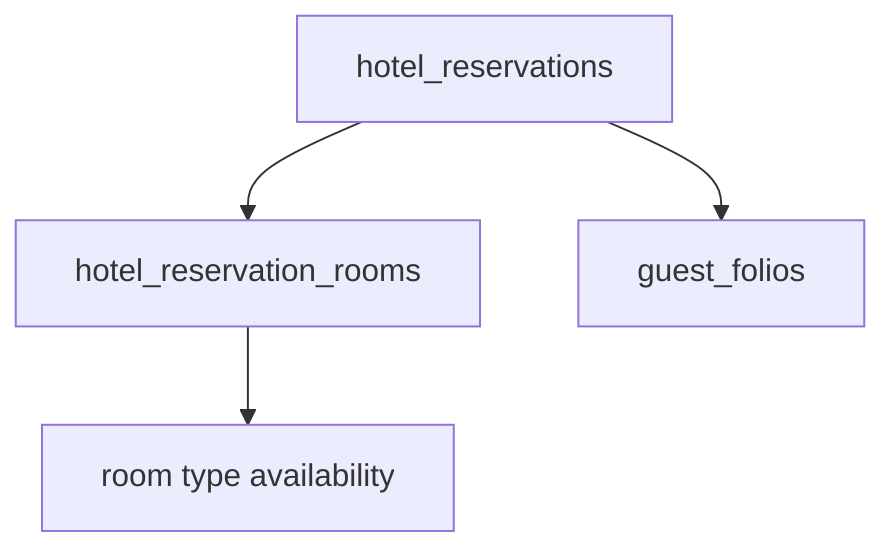

# STAY-08 Multi-Room Architecture

| Field | Value |
|---|---|
| Status | Living implementation plan |
| Basis | Current local tree audit, 2026-10-13 |
| Runtime authority today | `hotel_reservation_rooms` for room and stay-unit data. Master columns that remain are aggregates or the unit 1 pointer. |
| This run | STAY-08G room-unit authority. No later phase was implemented. |

Do not start a later phase from this file until that phase is explicitly commissioned.

## Current-state audit

The 2026-10-13 audit found no `hotel_reservation_rooms` table. STAY-08A has since added that table and backfilled one unit per reservation. A booking is still one row in `hotel_reservations` (`drizzle/migrations/0013_create_hotel_reservations.sql`):

- one `room_type_id`
- one nullable `room_id`
- one `arrival_date` / `departure_date`
- one occupancy (`adults`, `children`, and later `infants`)
- one `confirmation_number` unique per property

Later columns on that same row hold `rate_plan_id`, `currency`, `room_subtotal`, `nightly_rate_snapshot`, `priced_at` (`0016_create_hotel_rates.sql`), `infants`, and `rooms_requested` (`0116_pms_rate_plan_policies_quote.sql`, check `>= 1`, default 1). Stay amendments in `0151_amend_hotel_stay_priced.sql` are operational for this single-room model and price with a literal room count of 1.

Inventory (`0095_pms_room_inventory_operational_foundation.sql`) counts `hotel_reservations` rows. An assigned stay pins that physical room. An unassigned stay adds one unit of type demand (`unrepresented_reservation_demand`). `rooms_requested` is not read. Overlap is limited to `pending`, `confirmed`, and `checked_in`.

Packages live on `hotel_reservation_packages` with `charge_basis = 'per_stay'` and a unique key of reservation plus package activation. Cashiering has one `guest_folios` row per reservation (`guest_folios_one_per_reservation`). `folio_transactions` carries `reference_type` / `reference_id`, not a room-unit id.

Front Office status changes go through `check_in_hotel_reservation` and `check_out_hotel_reservation` on the master. Assign room, change room, no-show, and cancel also target that one `room_id`. Stay, Rooms, Rates, calendar, desk, housekeeping, night audit, and reports read the master columns. History is `hotel_reservation_history`, keyed to the master.

Same-property composite foreign keys are the project pattern: `(id, restaurant_id)` on reservations, room types, rooms, and rate plans. History and packages use `ON DELETE CASCADE` from the reservation. Room and room-type references do not cascade.

Next unused migration number at the time of this audit was `0153`. STAY-08G uses `0158`. The next unused number is `0159`. Recent stay migrations are byte-identical dual-lane copies. Agents do not apply migrations.

## Locked target architecture

`hotel_reservations` remains the booking: confirmation number, guest, master status, commercial attribution, policy snapshots, and booking-level notes.

`hotel_reservation_rooms` is one actual reserved room unit per row. One booking may own many units. STAY-08G makes those rows the room authority. Master columns that remain are aggregates or the unit 1 compatibility pointer.

Unit columns:

- `id`, `restaurant_id`, `reservation_id`, `unit_sequence`
- `room_type_id`, nullable `room_id`
- `arrival_date`, `departure_date`
- `adults`, `children`, `infants`
- nullable `rate_plan_id`, `currency`, `nightly_rate_snapshot`, `room_subtotal`, `priced_at`
- `created_at`, `updated_at`

No unit status column in STAY-08A. STAY-08E adds `status` on `hotel_reservation_rooms` because partial check-in, checkout, no-show, and cancel cannot be stored on the master alone.



## Non-goals

- A second reservation per room
- Treating `rooms_requested` as allocated rooms, inventory, or folio rooms
- Independent per-room dates before a later commissioned phase
- A frontend-only multi-room display
- Dropping legacy columns while reservation detail, reports, and guest profiles still select them
- Destructive `CASCADE` when retiring legacy columns
- Applying migrations from an agent

## Compatibility strategy

- Existing single-room reservations keep working.
- Confirmation numbers stay on the master.
- One booking can have multiple room units.
- Legacy columns stay as booking aggregates or the unit 1 compatibility pointer.
- Inventory, pricing, Front Office, and finance move before legacy retirement.
- Settings remains the master-data owner.
- Front Office remains the operational command owner.
- STAY-08B reads `hotel_reservation_rooms` for Reservation Detail only. Create, amend, inventory, pricing, Front Office, packages, folio, and calendar do not write or read it.

## Migration strategy

- Inspect both migration folders before adding a file.
- Use the next unused number. STAY-08A uses `0153`.
- Keep Drizzle and Supabase copies byte-identical.
- Do not apply from an agent.
- Do not edit `0106`, `0150`, `0151`, or `0152`.

## Rollback / safety strategy

STAY-08A adds a new table and backfills it. Rollback, if the migration has been applied and nothing else references the table, is `DROP TABLE public.hotel_reservation_rooms`. That drop removes only the child rows. It does not alter `hotel_reservations`. Do not drop the master table.

The reservation foreign key uses `ON DELETE CASCADE` because history and packages already do. Deleting a booking removes its units instead of leaving orphans. Room, room-type, and rate-plan foreign keys do not cascade, so deleting a room cannot delete a stay unit.

## Phase dependency graph


08E status rules below are locked for planning. Re-check them against the live Front Office writers at the start of 08E before writing a status column.

## STAY-08A

- Goal: persist one room-unit row per existing reservation without changing runtime authority.
- Scope: table, same-property constraints, indexes, RLS, idempotent backfill, migration-time equality assertion.
- Explicit non-scope: no reader switch, no Create UI change, no inventory change, no pricing change, no Front Office change, no folio change, no sync trigger, no unit status column.
- Prerequisites: none. `hotel_reservation_rooms` is absent.
- DB changes: `0153_hotel_reservation_rooms.sql`.
- Backend changes: none.
- Read-model changes: none. Do not add the table to `RESERVATION_DETAIL_SELECT`.
- UI changes: none.
- Compatibility requirements: master columns stay authoritative. Backfill copies them onto `unit_sequence = 1`.
- Tests: source scan of the migration and byte-identical Supabase copy.
- Manual verification: apply `0153` on a database that already has reservations and confirm one matching child per master. Not done by the agent.
- Acceptance criteria: every existing reservation has one child; backfilled values match the master at migration time; no runtime reader or writer changes.
- Rollback/safety notes: drop the new table only. See Rollback / safety strategy.
- Expected files: both `0153` copies, this plan, and `src/packages/pms/lib/reservation-room-units.test.ts`.
- Status: PASS
- Debt: no ongoing sync. A later master amend can still drift the child until a later phase owns the writer. Migration `0153` is applied and the backfill was runtime-verified outside this read-model change.

## STAY-08B

- Goal: teach NORU to read room units while the master fields stay authoritative.
- Scope: room-unit DTO, Reservation Detail `rooms[]`, comparison with legacy room fields, single-room screen unchanged.
- Explicit non-scope: no multi-room create, no inventory switch, no pricing switch, no Front Office lifecycle change.
- Prerequisites: STAY-08A applied, or the read path must tolerate a missing table the same way other unapplied columns are handled. Do not start until commissioned.
- DB changes: none expected.
- Backend changes: load units for the detail read model.
- Read-model changes: `rooms[]` beside the legacy room fields.
- UI changes: none. Reservation Detail already renders `roomTypeName`, `roomNumber`, dates, and occupancy from the master. `rooms[]` is on the detail payload and is not drawn, so a single room looks the same.
- Compatibility requirements: unit values are compared with the master. The master wins on disagreement.
- Tests: one matching unit; a drifted unit keeps the master on the published fields and keeps the child under `stored`; detail loads the table and create/amend do not.
- Manual verification: open an existing reservation detail and confirm the room, dates, and price match the master. Not done in this run.
- Acceptance criteria: every existing reservation reads one unit when `0153` is present; a missing table returns `rooms: []` and the master detail still loads; no visual regression for single-room stays.
- Rollback/safety notes: stop reading the child. The table can remain.
- Expected files: `src/packages/pms/lib/reservation-room-units.ts`, `src/packages/pms/lib/reservations.functions.ts`, `src/packages/pms/lib/reservation-room-units.test.ts`. The detail workspace was left unchanged on purpose.
- Status: PASS WITH DEBT
- Read-model shape: `ReservationRoomUnit` is `id`, `unitSequence`, `authority` (`master` for the only unit, `unit` if more than one row exists), `matchesMaster`, `driftedFields`, the room fields, and `stored`.
- Drift handling: compared fields are room type, room, dates, adults, children, infants, rate plan, currency, nightly rates, room subtotal, and priced-at. Money matches to the cent. Timestamps match as instants. For one unit, the published fields are copied from the master and `stored` keeps the child. Drift is not written back.
- Debt: signed-in detail was not opened in this run. Drift is detected and not repaired. `rooms[]` is not rendered.

### STAY-08B files changed

- `src/packages/pms/lib/reservation-room-units.ts`
- `src/packages/pms/lib/reservations.functions.ts` (`getReservation` only)
- `src/packages/pms/lib/reservation-room-units.test.ts`
- `docs/pms/stay-08-multi-room-implementation-plan.md`

No migration. Create, amend, inventory, pricing, Front Office, packages, folio, and calendar were not edited.

## STAY-08C

- Goal: New Reservation creates genuine multiple room units.
- Scope: draft room units, Add Room / Remove Room, per-unit room type, occupancy, rate plan, and price preview. Transaction inserts the master and every unit. Step 4 lists rooms individually. All units share the master arrival and departure.
- Explicit non-scope: independent per-room dates, room-level check-in/out, folio splitting, named occupants, inventory authority, pricing authority, Front Office lifecycle.
- Prerequisites: STAY-08B pass. Met.
- DB changes: `0154_create_reservation_room_units.sql` replaces `create_hotel_reservation_priced` and `create_hotel_reservation_priced_commercial` with a trailing `_room_units jsonb DEFAULT NULL`. Not applied.
- Backend changes: `createReservation` forwards `_room_units` only when more than one room is requested. It does not insert child rows after the RPC returns.
- Read-model changes: none. Detail still uses the STAY-08B projection.
- UI changes: New Reservation Step 1 extra rooms and Step 4 room lines.
- Compatibility requirements: a one-room create omits `_room_units` and still sends `roomsRequested` as `_rooms`.
- Tests: `reservation-room-units.test.ts` 9/9, including five STAY-08C cases.
- Manual verification: not done. New Reservation redirects to restaurant login.
- Acceptance criteria: two child rows, one confirmation number, atomic rollback. Met in the function body. Runtime apply is still required.
- Rollback/safety notes: restore the 0116 and 0126 function bodies. Do not insert units after the master RPC commits.
- Status: PASS WITH DEBT

Create payload when there is one room: the existing scalar stay fields, with `rooms` equal to `roomsRequested`, and no `roomUnits`.

Create payload when there are extra rooms:

```json
{
  "rooms": 1,
  "roomUnits": [
    {
      "roomTypeId": "first-room-type",
      "adults": 2,
      "children": 0,
      "infants": 0,
      "ratePlanId": "first-plan"
    },
    {
      "roomTypeId": "second-room-type",
      "adults": 1,
      "children": 1,
      "infants": 0,
      "ratePlanId": "second-plan"
    }
  ]
}
```

The first element must match the scalar `roomTypeId`, occupancy, and `ratePlanId`. The RPC receives `_room_units` as snake_case jsonb (`room_type_id`, `adults`, `children`, `infants`, `rate_plan_id`). `_rooms` is 1, so the master price is the first room and is not multiplied by `rooms_requested` and is not the sum of the units.

Transaction boundary: `create_hotel_reservation` writes the master and its history, the priced function writes the master price and every `hotel_reservation_rooms` row, and the commercial wrapper then calls `sync_hotel_reservation_promotion` and `sync_hotel_reservation_packages`. Those statements share one Postgres transaction. A failure in pricing, occupancy, or package sync rolls the master, the history row, the room units, and the package rows back together. Group attach, walk-in source, step 3 commercial fields, and the deposit snapshot remain the existing writes after the RPC returns. They are not room-unit inserts.

Single-room compatibility: the client omits `_room_units`, so the call matches the current 0116/0126 signature until 0154 is applied. After 0154, a null `_room_units` still inserts one child copied from the priced master, including the existing `rooms_requested` multiplier.

Step 1: `extraRoomUnits` is stored on draft version 1. A missing array parses as `[]`. Add Room stays disabled until an availability search returns room types, and it is limited to 19 additional rooms. Remove Room deletes an additional room only. Each additional room has its own room type, adults, children, infants, rate plan, and a `quoteStay` preview with `rooms: 1`. Arrival and departure stay on the master. While additional rooms exist, the Rooms stepper is forced to 1 and disabled so it cannot multiply the first room.

Step 4: `roomLines` is passed only when more than one unit exists. The review then lists every room with occupancy, rate plan, and quoted total. A one-room review does not render that list.

Packages stay reservation-scoped. The commercial function still calls `sync_hotel_reservation_packages` once, with apply mode, on the reservation id. A package is not copied onto each room. `charge_basis` stays `per_stay`.

Debt: 0154 is not applied. Inventory still counts reservation rows, so a second unit does not consume a second room. The master `room_subtotal` is the first room, not the sum of the units. Later master amends can still drift the children. Group pickup and travel-agent checks still use the first room type. Signed-in New Reservation was not opened.

## STAY-08D

- Goal: room units consume inventory and own their price.
- Scope: each unassigned unit counts as one room-type inventory unit; each assigned unit uses the physical-room conflict check; price each unit; reservation room total equals the sum of unit subtotals; master price fields are compatibility aggregates written in the same transaction.
- Explicit non-scope: room-level Front Office lifecycle, folio redesign, Calendar UI redesign.
- Prerequisites: STAY-08C pass. Met in code. `0154` still has to be applied before `0155`.
- DB changes: `0155_room_unit_inventory_price.sql`. Not applied.
- Backend changes: create checks every unit before return. A one-unit amend syncs that unit and writes the aggregate. A multi-room change of dates, room, occupancy, or rate plan is refused.
- Read-model changes: rate calendar and demand sold counts use `projectInventoryDemand`.
- UI changes: none. The master `room_subtotal` becomes the sum, so existing total labels follow it.
- Compatibility requirements: one unit consumes one room and keeps that unit's price, including a one-room `rooms_requested` price multiplier. `rooms_requested` is not an inventory quantity.
- Tests: `reservation-room-units.test.ts` 12/12.
- Manual verification: not done. Apply `0154`, then `0155`, then create one room and two rooms in a signed-in session.
- Acceptance criteria: unit counts replace reservation-row counts; the room total is the sum; a failed unit rolls the booking back. Met in the function body. Runtime apply is still required.
- Rollback/safety notes: restore the 0095 availability and assignment functions and the 0154/0151 create and amend bodies.
- Status: PASS WITH DEBT

Inventory authority: `pms_room_type_availability` counts `hotel_reservation_rooms`. An unassigned unit consumes one room of its type. An assigned unit pins that physical room through `pms_stay_overlaps_room`, which `assert_room_assignable`, assignment preview, and block activation all use. A booking that has no unit row still counts as one room, so stays created before `0154` do not disappear from inventory. `rooms_requested` is not read.

Pricing authority: each unit keeps its own rate plan, occupancy, currency, nightly snapshot, room subtotal, and `priced_at`. `sync_reservation_room_total` writes the master compatibility price. One unit copies that unit onto the master, so a one-room stay keeps its current total. Two or more units set `room_subtotal` to `sum(unit.room_subtotal)` and the nightly snapshot to the sum of nightly rates by date. The master room, rate plan, and occupancy stay on the first room.

Create transaction: after the unit inserts, and before `RETURN`, the priced function calls `assert_reservation_room_units` and then `sync_reservation_room_total`. If any unassigned unit does not fit, the function raises `NO_AVAILABILITY`. If two units of the same booking claim one physical room, or an assigned unit overlaps another stay, it raises `ROOM_ALREADY_BOOKED`. Either raise rolls back the master, history, units, and package rows. The commercial wrapper is unchanged and still syncs packages once for the reservation.

Amend behavior: a stay with more than one room unit cannot change dates, room, occupancy, or rate plan. The function raises `MULTI_ROOM_AMEND_UNSUPPORTED` before `amend_hotel_reservation`, so the aggregate cannot be replaced by the first room's price. Notes and other unchanged-stay saves still go through. A one-unit stay amends as it does today, then the child row is copied from the master and the master total is set from that one unit. Package reevaluation stays the existing reservation-level `reevaluate` call.

Calendar and demand: `rate-calendar.server.ts` and `demand.server.ts` emit one sold stay per room unit. The calendar screens are not redesigned. Front Office check-in, check-out, no-show, and the other lifecycle writers are not in this migration.

Debt: `0154` and `0155` are not applied. Signed-in create was not opened. Multi-room date, room, occupancy, and rate amendments are refused until a later phase can reprice every unit safely. Group and travel-agent checks still use the first room type.

## STAY-08E

- Goal: Front Office commands target room units, with an explicit master rollup.
- Scope: Assign Room, Change Room, Check In, Check Out, No-show, and cancellation effects.
- Explicit non-scope: folio and package attribution. That remains STAY-08F. STAY-08F was not started.
- Prerequisites: STAY-08D pass. Met in code. `0154` and `0155` still have to be applied before `0156`.
- DB changes: `0156_room_unit_front_office.sql`. Not applied. Adds `hotel_reservation_rooms.status` and replaces the Front Office command functions.
- Backend changes: multi-room commands take `hotel_reservation_rooms.id`. A single room omits that id and the function resolves the only unit. A missing id on a multi-room stay raises `ROOM_UNIT_REQUIRED`.
- Read-model changes: detail can read unit status when the column exists, and falls back when it does not.
- UI changes: the existing Assign, Check In, Change Room, Check Out, Cancel, and No-show dialogs ask which room when the stay has more than one. A one-room stay does not show that picker.
- Compatibility requirements: a one-unit reservation still uses the existing assign, check-in, checkout, no-show, and cancel handlers. The master `room_id` follows room 1.
- Tests: `reservation-room-units.test.ts` covers rollup, one-unit targeting, physical conflict, history on the master, and no folio or package rewrite.
- Manual verification: not done. Apply `0154`, then `0155`, then `0156`. Walk one room unchanged, then check in one room of a two-room stay, then the other, then check out one, then the other.
- Acceptance criteria: commands hit the chosen unit; the master status is the rollup; the single-room flow matches today. Met in the function bodies. Runtime apply is still required.
- Rollback/safety notes: the unit write and `rollup_hotel_reservation_status` run in the same transaction.
- Status: PASS WITH DEBT

### Front Office writer audit

The live writers before this phase updated only `hotel_reservations`:

- Assign Room calls `amend_hotel_reservation` and writes the master `room_id`.
- Change Room is `move_hotel_reservation_room`. It requires the master to be `checked_in`, keeps the same room type, and writes the master `room_id`.
- Check In is `check_in_hotel_reservation`. It requires master `confirmed`, assigns one room, sets master `checked_in`, opens the reservation folio, and runs housekeeping on that room.
- Check Out is `check_out_hotel_reservation`. It requires master `checked_in` and sets master `checked_out`.
- No-show is `mark_hotel_reservation_no_show`, then the desk clears the master `room_id`.
- Front Office cancel updates the master status to `cancelled` and clears the master `room_id`. Booking confirm and reactivate use `setReservationStatus` on the master.

None of those paths can record that one room is in house while another is still due. A unit `status` column is required. The six values already used on the reservation are enough. No extra state was added.

### Status model for STAY-08E

`pending`, `confirmed`, `checked_in`, `checked_out`, `cancelled`, `no_show`

Allowed unit transitions follow the current master rules, scoped to one unit:

- `pending` → `confirmed`, `cancelled`
- `confirmed` → `cancelled`, `checked_in`, `no_show` when that unit is due
- `checked_in` → `checked_out`, and Change Room stays on the checked-in unit
- `checked_out`, `cancelled`, and `no_show` do not return to an active unit status through these commands

Master rollup, first match, in `rollup_hotel_reservation_status` and `rollupReservationStatus`:

1. Every unit `cancelled` → master `cancelled`
2. Every unit that is not `cancelled` is `no_show`, and at least one unit is `no_show` → master `no_show`
3. Any unit `checked_in` → master `checked_in`
4. Any unit `checked_out` and none still `pending`, `confirmed`, or `checked_in` → master `checked_out`
5. Any unit `confirmed` → master `confirmed`
6. Otherwise master `pending`

A stay with no unit row keeps the master status the command already wrote. Partial check-in leaves the master `checked_in`. Partial checkout leaves the master `checked_in` until no unit remains `checked_in`. One cancelled or no-show unit does not cancel or no-show its siblings. Booking-level confirm, reactivate, and cancel still apply to every unit, because that command is for the whole reservation.

Assign and Change Room call `assert_room_assignable` for the chosen unit's type and dates, then reject a sibling unit that already holds that physical room with `ROOM_ALREADY_BOOKED`. History stays on `hotel_reservation_history`. The event payload adds `reservation_room_id` and `unit_sequence`. The master `room_id` is copied from room 1 so existing single-room readers keep a room. Another unit's assignment does not replace that room.

Debt: `0154`, `0155`, and `0156` are not applied. Signed-in Front Office was not opened. Folio and package attribution were not changed in this phase. STAY-08G later derives the unit 1 pointer and the occupancy and money aggregates from the units.

## STAY-08F

- Goal: folio and package attribution can name a room unit without splitting the folio.
- Scope: keep one `guest_folios` row per reservation. Nullable `reservation_room_id` on `folio_transactions` and on `hotel_reservation_packages`.
- Explicit non-scope: automatic duplication of a package onto every room; a second folio per room; per-night or per-person execution; Front Office lifecycle changes. Room-unit authority was left to STAY-08G.
- Prerequisites: STAY-08E pass. Met in code. `0154`, `0155`, and `0156` still have to be applied before `0157`.
- DB changes: `0157_room_unit_folio_packages.sql`. Not applied. Adds the nullable column, a same-property foreign key, and the room-package function. Does not update existing ledger rows.
- Backend changes: a one-room stay still posts one reservation-wide room charge. A two-room stay posts one charge per unit. `sync_hotel_reservation_packages` still writes one reservation-level row. `apply_hotel_reservation_room_package` writes one room row.
- Read-model changes: folio lines and applied packages show `Room {sequence}` only when `reservation_room_id` is set. A missing column falls back to the previous select.
- UI changes: that label on the folio description and the applied-package name. The package attach control still refuses from the detail workspace.
- Compatibility requirements: a one-room folio has no unit label. Existing postings stay null.
- Tests: `reservation-room-units.test.ts` covers one folio, null versus unit attribution, package scope, and no Front Office rewrite.
- Manual verification: not done. Apply `0154`, then `0155`, then `0156`, then `0157`. Open a one-room folio and a two-room folio, and compare one reservation package with one explicit room package.
- Acceptance criteria: attribution is explicit; packages do not duplicate; the single-room folio is unchanged. Met in the function bodies. Runtime apply is still required.
- Rollback/safety notes: the new columns are nullable. Historical `folio_transactions` rows are not rewritten. Ledger updates remain blocked.
- Status: PASS WITH DEBT

### Cashiering audit

Room accommodation is not a second folio. `guest_folios_one_per_reservation` in `0017_create_cashiering.sql` still allows one `guest_folios` row per reservation. The posting table is `folio_transactions`. `open_folio_for_reservation` in `0135_cashiering_phase4_tax_on_post.sql` posts one `reservation_room_charge` through `post_folio_charge_with_tax`, with `reference_id` equal to the reservation and the amount equal to `room_subtotal`. The unique index `folio_transactions_room_charge_once` allows one such line per reference. `0110_cashiering_phase0_ledger_safety.sql` blocks UPDATE and DELETE on `folio_transactions`, so attribution has to be set on insert. Tax and service lines are separate inserts and do not use `reference_type = 'reservation_room_charge'`.

`0157` keeps that function's three arguments. A stay with zero or one room unit still posts the reservation-wide line and does not set `noru.reservation_room_id`, so `reservation_room_id` stays null. A stay with two or more units posts one line per unit whose `room_subtotal` is positive: `reference_id` and `reservation_room_id` are that unit, and the amount is that unit's subtotal. If a reservation-wide room charge already exists, the function leaves it and does not add unit lines on top. A later open that finds the unit line does not post it again. The BEFORE INSERT trigger copies `noru.reservation_room_id` only onto `reservation_room_charge` rows. Payments, deposits, taxes, and other categories stay null. Check-in still calls `open_folio_for_reservation` once for the reservation. `0156` is unchanged.

### Package model audit

`hotel_reservation_packages` in `0104_pms_commercial_engine_foundation.sql` has `charge_basis` constrained to `per_stay`, quantity default 1, and a unique key of reservation plus activation. It cannot name a room. `sync_hotel_reservation_packages` in `0150_sync_hotel_reservation_packages_activation_id.sql` inserts one row per selected activation, quantity 1, `unit_amount` and `applied_amount` equal to `package_price`. A non-`per_stay` activation raises `PACKAGE_CHARGE_BASIS_UNSUPPORTED` and is not executed. Catalog charge bases in `0125_pms_package_charge_basis.sql` are wider. This phase does not execute them.

`0157` adds nullable `reservation_room_id`. Null remains the reservation package. A value is that package for one unit. The old table unique is replaced by two partial unique indexes so a reservation row and a room row are different scopes, and the same activation can be explicit on two units without being copied. Sync still inserts `reservation_room_id` null, reevaluates only null rows, and deletes only null rows. It does not read `hotel_reservation_rooms`. `apply_hotel_reservation_room_package` inserts exactly one row for the chosen unit, `charge_basis = 'per_stay'`, quantity 1, and both amounts equal to `package_price` once. It uses that unit's room type and rate plan. It does not loop sibling units and does not post the package to the folio. A reservation-level row of the same activation blocks the room apply. A room row of the same activation blocks a later reservation apply.

Debt: `0154`, `0155`, `0156`, and `0157` are not applied. Signed-in Cashiering was not opened. The detail package buttons still do not attach a package. Room-package apply is the explicit RPC.

## STAY-08G

- Goal: room units are the room and stay-unit authority. Master columns that remain are aggregates or a compatibility pointer.
- Scope: classify every legacy field, switch operational room readers, and make `sync_reservation_room_total` the aggregate writer.
- Explicit non-scope: dropping a column because the unit table exists; `CASCADE` on those drops; a second folio; independent per-room dates as a new product feature.
- Prerequisites: STAY-08F pass. Met in code. Apply `0154`, `0155`, `0156`, and `0157` before `0158`.
- DB changes: `0158_room_unit_authority.sql`. Not applied. Replaces the aggregate sync and adds a deferred trigger. Does not drop a column.
- Backend changes: housekeeping, the room board, front office occupancy, the reservation calendar, night audit room checks, go-live occupied rooms, and revenue room nights read units. One booking with no unit row still counts as one room.
- Read-model changes: a room unit publishes its own stored values, including when it is the only unit. Drift against the master is still visible.
- UI changes: a one-room detail stay still shows the single room. A multi-room stay lists `Room {sequence}` for each unit.
- Compatibility requirements: confirmation number, guest, status, policies, and notes stay on the booking. One folio stays on the booking.
- Tests: `reservation-room-units.test.ts` covers the aggregate sync, no column drop, unit expansion, and distinct reservation versus room rows.
- Manual verification: not done. Apply `0154` through `0158`. Compare a one-room stay with a two-room stay on housekeeping, the calendar, and the folio.
- Acceptance criteria: units are authoritative; retained aggregates are named; no destructive cascade. Met in the function bodies. Runtime apply is still required.
- Rollback/safety notes: drop the deferred trigger and restore the `0155` body of `sync_reservation_room_total`. Do not drop the columns.
- Status: PASS WITH DEBT

### Final authority matrix

| Field | Class | Rule |
|---|---|---|
| `room_id` | Compatibility pointer | Copied from `unit_sequence` 1. Occupancy, housekeeping, calendar, and night audit read units. |
| `room_type_id` | Compatibility pointer | Copied from `unit_sequence` 1. Inventory and revenue room nights read each unit. |
| `rate_plan_id` | Compatibility pointer | Copied from `unit_sequence` 1. Reservation-scoped packages still use this pointer. Room-scoped packages use the unit. |
| `rooms_requested` | Compatibility mirror | Set to the count of active units. Inventory does not read it. |
| `adults`, `children`, `infants` | Booking aggregate | Sum of units whose status is not `cancelled` or `no_show`. |
| `nightly_rate_snapshot` | Booking aggregate | One active unit copies that snapshot. Several active units sum the nightly rate by date. |
| `room_subtotal` | Booking aggregate | Sum of `room_subtotal` on active units. The single-room folio still reads this total. A multi-room folio posts each unit. |
| `priced_at` | Booking aggregate | Set when an active unit has been priced. |
| `currency` | Booking invariant | Updated only when every active unit shares one currency. |
| `arrival_date`, `departure_date` | Booking window | Not rewritten from units. Unit dates are what operational room readers use when a unit row exists. |

Active units are every unit except `cancelled` and `no_show`. Checked-out units stay in the money and occupancy sums. When no active unit remains, occupancy and money are left as they are, and the compatibility pointer is still refreshed from unit 1.

`sync_reservation_room_total` is the only aggregate writer. A deferred constraint trigger calls it at the end of any insert, update, or delete of `hotel_reservation_rooms`, so a master write earlier in the same transaction is replaced by the unit aggregate.

### Readers left on the booking

Desk, search, and quick view still show one row per reservation. The room number on that row is the compatibility pointer. Guest, company, travel-agent, and group links stay on the booking. Reservation-scoped package sync still evaluates the compatibility room type and rate plan. Cashiering keeps one folio. Night audit counts a duplicate room charge by `reference_id`, which is the reservation for a one-room charge and the unit for a multi-room charge.

Debt: `0154` through `0158` are not applied. Signed-in housekeeping, calendar, and folio were not opened. Multi-room date, occupancy, and rate amendments are still refused. A desk row does not list every room number. Physical room numbers on the detail stay list are sequence labels until the room join is loaded. Columns were not dropped because reservation detail, front office previews, reports, and guest profiles still select them.

## Test strategy

Focused tests per phase. Do not run unrelated suites.

| Phase | Coverage |
|---|---|
| STAY-08A | Table, sequence 1 backfill, equality assertion, no pricing or availability rewrite, dual-lane copy |
| STAY-08B | One reservation, one unit, values match the master |
| STAY-08C | Two rooms, different types and occupancy, create rollback, single-room create |
| STAY-08D | Inventory consumption, physical conflict, price sum |
| STAY-08E | Assign, partial and full check-in, partial and full checkout, no-show, cancel |
| STAY-08F | Room charge attribution, reservation-wide charge, package scope |
| STAY-08G | No competing writer, legacy classification |

## Manual verification checklist

- Apply `0153` and confirm one child per existing reservation.
- Open an existing single-room detail after 08B and confirm it looks unchanged.
- Create a one-room and a two-room reservation after 08C.
- Confirm a three-unit stay consumes three inventory units after 08D.
- Check in one room of a two-room stay after 08E, then the other.
- Post a room charge and a stay charge after 08F.
- Search for remaining master room writers before any 08G drop.

## Known risks

- 0150, 0151, and 0152 are already unapplied. 0153 depends on `infants`, `rate_plan_id`, `currency`, `room_subtotal`, `nightly_rate_snapshot`, and `priced_at`, which exist in earlier migrations, not on 0150–0152.
- Without a sync trigger, master amends after the backfill drift the child until a later phase writes units.
- `getReservation` treats a missing `hotel_reservation_rooms` relation as `rooms: []`. Any other read error still fails the detail request.
- Duplicate numeric prefixes exist in older migrations (`0126`, `0125`, and others). `0158` is the STAY-08G migration. The next unused number is `0159`.

## Technical debt

- No sync from master room columns onto the single child after STAY-08A.
- Unit status is stored by `0156`, which is not applied yet.
- Package charge basis on a reservation row is still only `per_stay`. A room package is the same price once for one unit.
- `rooms_requested` remains a non-authoritative column.
- 0154, 0155, 0156, and 0157 are written and not applied. Multi-room create, inventory, Front Office, and folio attribution wait on that apply.
- A reservation with more than one room cannot yet change dates, room, occupancy, or rate plan. That guard keeps the aggregate intact.
- Master room columns remain. They are aggregates or the unit 1 compatibility pointer. They were not dropped.

## Phase status table

| Phase | Status | Migration | Tests | Runtime verified | Debt |
|---|---|---|---|---|---|
| STAY-08A | PASS | 0153 applied | 1/1 | Yes | no ongoing sync |
| STAY-08B | PASS WITH DEBT | none | 4/4 | No | drift detected, not repaired; detail screen not opened |
| STAY-08C | PASS WITH DEBT | 0154 not applied | 9/9 | No | inventory and master price still one room; login blocked the create screen |
| STAY-08D | PASS WITH DEBT | 0155 not applied | 12/12 | No | apply 0154 first; multi-room stay fields are not amendable |
| STAY-08E | PASS WITH DEBT | 0156 not applied | 14/14 | No | apply 0154 and 0155 first; master room still follows room 1 |
| STAY-08F | PASS WITH DEBT | 0157 not applied | 15/15 | No | apply 0154, 0155, and 0156 first; one folio per reservation |
| STAY-08G | PASS WITH DEBT | 0158 not applied | 16/16 | No | columns kept; apply 0154–0157 first |

## Files / functions / migrations touched by phase

### STAY-08A

- `docs/pms/stay-08-multi-room-implementation-plan.md`
- `drizzle/migrations/0153_hotel_reservation_rooms.sql`
- `supabase/migrations/0153_hotel_reservation_rooms.sql`
- `src/packages/pms/lib/reservation-room-units.test.ts`

No application functions. `price_hotel_stay`, `pms_room_type_availability`, `amend_hotel_reservation_priced`, and `RESERVATION_DETAIL_SELECT` stay unchanged.

### STAY-08B

- `src/packages/pms/lib/reservation-room-units.ts`
- `src/packages/pms/lib/reservations.functions.ts`
- `src/packages/pms/lib/reservation-room-units.test.ts`
- `docs/pms/stay-08-multi-room-implementation-plan.md`

`getReservation` loads `hotel_reservation_rooms` after the master row. `toDetail` still maps the master room columns. The detail workspace still renders those master fields.

### STAY-08C

- `drizzle/migrations/0154_create_reservation_room_units.sql`
- `supabase/migrations/0154_create_reservation_room_units.sql`
- `src/packages/pms/lib/reservations.functions.ts`
- `src/packages/pms/lib/reservations.server.ts`
- `src/packages/pms/lib/reservation-room-units.ts`
- `src/packages/pms/lib/reservation-room-units.test.ts`
- `src/packages/pms/lib/create-reservation-draft.ts`
- `src/packages/pms/lib/create-reservation-draft.test.ts`
- `src/packages/pms/components/bookings/create-reservation-extra-rooms.tsx`
- `src/packages/pms/components/bookings/create-reservation-page.tsx`
- `src/packages/pms/components/bookings/create-reservation-review.tsx`
- `src/integrations/supabase/types.ts`
- `docs/pms/stay-08-multi-room-implementation-plan.md`

`amend_hotel_reservation_priced`, `pms_room_type_availability`, Front Office commands, folio attribution, and package charge basis were not changed.

### STAY-08D

- `drizzle/migrations/0155_room_unit_inventory_price.sql`
- `supabase/migrations/0155_room_unit_inventory_price.sql`
- `src/packages/pms/lib/reservation-room-units.ts`
- `src/packages/pms/lib/reservation-room-units.test.ts`
- `src/packages/pms/lib/reservations.server.ts`
- `src/packages/pms/lib/revenue/rate-calendar.server.ts`
- `src/packages/pms/lib/revenue/demand.server.ts`
- `docs/pms/stay-08-multi-room-implementation-plan.md`

`check_in_hotel_reservation`, `check_out_hotel_reservation`, folio posting, and package charge basis were not changed.

### STAY-08E

- `drizzle/migrations/0156_room_unit_front_office.sql`
- `supabase/migrations/0156_room_unit_front_office.sql`
- `src/packages/pms/lib/reservation-room-units.ts`
- `src/packages/pms/lib/reservation-room-units.test.ts`
- `src/packages/pms/lib/reservations.functions.ts`
- `src/packages/pms/lib/reservations.server.ts`
- `src/packages/pms/lib/frontoffice.functions.ts`
- `src/packages/pms/lib/fo-check-in.functions.ts`
- `src/packages/pms/lib/fo-check-out.functions.ts`
- `src/packages/pms/lib/fo-cancel-noshow.functions.ts`
- `src/packages/pms/components/frontoffice/front-office-dialogs.tsx`
- `src/packages/pms/components/frontoffice/room-unit-target-select.tsx`
- `src/packages/pms/components/frontoffice/fo-check-in-stepper.tsx`
- `src/packages/pms/components/frontoffice/fo-check-out-stepper.tsx`
- `src/packages/pms/components/frontoffice/fo-cancel-noshow-stepper.tsx`
- `src/packages/pms/components/workspaces/reservation-detail-workspace.tsx`
- `src/integrations/supabase/types.ts`
- `docs/pms/stay-08-multi-room-implementation-plan.md`

Folio tables, package charge basis, and posting attribution were not changed. STAY-08F was not started.

### STAY-08F

- `drizzle/migrations/0157_room_unit_folio_packages.sql`
- `supabase/migrations/0157_room_unit_folio_packages.sql`
- `src/packages/pms/lib/reservation-room-units.ts`
- `src/packages/pms/lib/reservation-room-units.test.ts`
- `src/packages/pms/lib/reservations.functions.ts`
- `src/packages/pms/lib/reservations.server.ts`
- `src/packages/pms/lib/cashiering.functions.ts`
- `src/packages/pms/lib/revenue/commercial-package.server.ts`
- `src/packages/pms/components/workspaces/reservation-detail-folio.tsx`
- `src/packages/pms/components/workspaces/reservation-detail-packages.tsx`
- `src/packages/pms/components/workspaces/reservation-detail-rates.tsx`
- `src/packages/pms/components/cashiering/guest-folio-page.tsx`
- `src/packages/pms/components/cashiering/folio-workspace-panels.tsx`
- `src/integrations/supabase/types.ts`
- `docs/pms/stay-08-multi-room-implementation-plan.md`

`check_in_hotel_reservation`, `check_out_hotel_reservation`, and the other Front Office command bodies were not changed in this phase.

### STAY-08G

- `drizzle/migrations/0158_room_unit_authority.sql`
- `supabase/migrations/0158_room_unit_authority.sql`
- `src/packages/pms/lib/reservation-room-units.ts`
- `src/packages/pms/lib/reservation-room-units.test.ts`
- `src/packages/pms/lib/reservations.functions.ts`
- `src/packages/pms/lib/housekeeping.functions.ts`
- `src/packages/pms/lib/room-board.functions.ts`
- `src/packages/pms/lib/frontoffice.functions.ts`
- `src/packages/pms/lib/reservation-workspace/calendar.server.ts`
- `src/packages/pms/lib/nightaudit.server.ts`
- `src/packages/pms/lib/revenue/revenue-analytics.ts`
- `src/packages/pms/lib/revenue/revenue-analytics.server.ts`
- `src/packages/pms/lib/pms-property-setup-card8-golive.functions.ts`
- `src/packages/pms/components/workspaces/reservation-detail-workspace.tsx`
- `docs/pms/stay-08-multi-room-implementation-plan.md`

No folio was added. No legacy column was dropped. No later phase was started.
